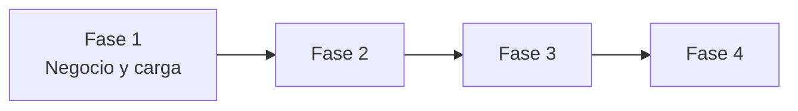
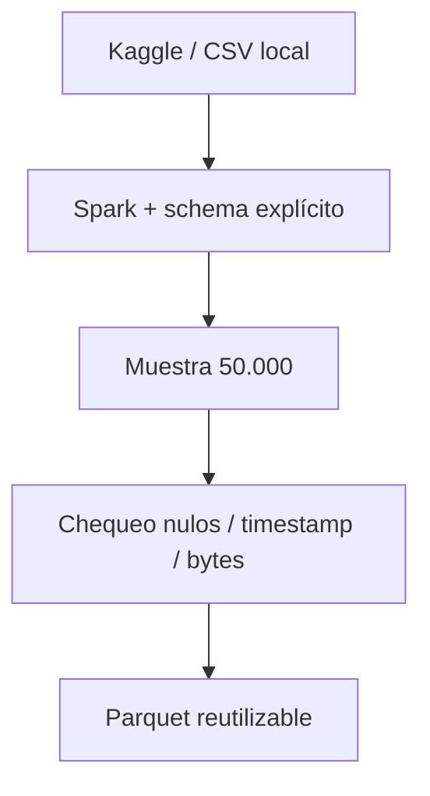

# Fase I — Entendimiento del negocio y carga de datos

**Módulo 5 · Unidad 2 · Proyecto aplicado**  
**Notebook:** [`M5U2_1_business_data_load.ipynb`](M5U2_1_business_data_load.ipynb)  
**Autor:** David Martinez

[← Volver al README del proyecto](../README.md)

---

## De qué trata esta fase

Definir el problema para un **SOC/CSIRT** y dejar el dataset cargado, validado y listo para las fases de exploración y modelado. La solución objetivo usa **ML + NLP + Deep Learning** para detectar y priorizar anomalías en logs de ciberseguridad (IT y OT).

Esta entrega **no** entrena modelos. Deja el marco de negocio, el contrato de datos y una muestra operativa reproducible.



---

## Estructura del notebook

| Sección | Contenido |
|---------|-----------|
| 1.1 Trasfondo | Cliente SOC/CSIRT, dominio de logs, problema de volumen y falsos positivos |
| 1.2 Alcance | Pipeline Spark + detección `benign` vs amenaza; uso esperado por analistas |
| 1.3 Plan | Semanas 1–4 (carga → features/NLP → baselines → calibración SOC) |
| 2.1 Origen | Kaggle *Cybersecurity Threat Detection Logs*; criterios de calidad |
| 2.2 Carga | Spark + esquema explícito + muestra 50k + Parquet |

---

## Qué se logró

### Marco de negocio

- **Beneficiarios:** centros de operaciones de seguridad (SOC/CSIRT) y personal de ciberseguridad en entornos **IT** y **OT**.
- **Problema:** millones de eventos; la revisión manual no escala; alertas sin priorizar aumentan el riesgo de pasar por alto incidentes.
- **Objetivo:** automatizar detección/clasificación de eventos inusuales, **reducir falsos positivos** y **priorizar** qué se revisa primero.
- **Señal mixta:** campos estructurados (IP, protocolo, acción, bytes) + texto (`user_agent`, `request_path`).

### Datos

| Indicador | Valor |
|-----------|------:|
| Universo reportado | ~**6 000 000** registros |
| Muestra para la entrega | **50 000** |
| Nulos en columnas clave (muestra) | **0** |
| Timestamps inválidos (muestra) | **0** |

Columnas: `timestamp`, `source_ip`, `dest_ip`, `protocol`, `action`, `threat_label`, `log_type`, `bytes_transferred`, `user_agent`, `request_path`.

Definición operativa de anomalía (para fases siguientes):

```text
is_anomaly = 1  si  threat_label != "benign"
is_anomaly = 0  en caso contrario
```

### Carga técnica



- Descarga opcional con `kagglehub` si el CSV no está en la carpeta.
- Esquema tipado (evita inferencia costosa a escala).
- Normalización mínima (`lower`/`trim` en categóricas) y parseo de `timestamp`.
- Muestra persistida en `data_samples/muestra_50k_parquet` para no releer 6M en cada corrida.

---

## Qué se aprendió

1. El producto no es “un accuracy alto”: es **menos ruido y mejor orden de revisión** para analistas.
2. Hay que diseñar el pipeline a **escala de millones** aunque la entrega trabaje con 50k.
3. Un **esquema explícito** en Spark es parte del contrato de datos hacia ML.
4. `threat_label` habilita supervisión; la etiqueta binaria `is_anomaly` es la formulación operativa de esta entrega.
5. Documentar calidad (nulos, timestamps, balance) en Fase 1 evita sorpresas en el EDA.

---

## Archivos en esta carpeta

| Archivo | Rol |
|---------|-----|
| `M5U2_1_business_data_load.ipynb` | Notebook de la entrega |

> El CSV completo (~96 MB comprimidos en Kaggle) y el Parquet de 50k se generan al ejecutar; no están versionados por tamaño.

---

## Cómo ejecutar

```bash
pip install pyspark pandas kagglehub
# Colocar cybersecurity_threat_detection_logs.csv aquí, o dejar que kagglehub lo descargue
jupyter notebook M5U2_1_business_data_load.ipynb
```

---

## Criterio de cierre

- Trasfondo y alcance claros para un beneficiario SOC.
- Plan de las fases siguientes.
- Carga ejecutable, con evidencia de cantidad y calidad.

Siguiente: [Fase II — EDA y preparación](../Entrega%20proyecto%20fase%20II/README.md).
