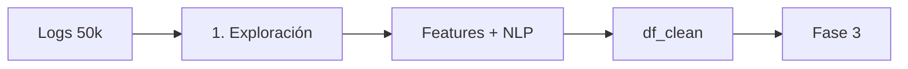

# Fase II — Entendimiento y preparación de los datos

**Módulo 5 · Unidad 3 · Proyecto aplicado**  
**Notebook:** [`M5U3_2_exploratory_data_analysis.ipynb`](M5U3_2_exploratory_data_analysis.ipynb)  
**Autor:** David Martinez

[← Volver al README del proyecto](../README.md)

---

## De qué trata esta fase

Explorar la muestra de **50 000** logs, entender desbalance y calidad, y construir el **feature set** que usarán las Fases 3 y 4. Aquí nacen las señales NLP sobre `request_path`, los flags estilo OWASP y la decisión de **excluir leakage**.



---

## Estructura del notebook (mapa)

| Bloque | Pregunta que responde |
|--------|----------------------|
| 1.1 Resumen | ¿Cuántos documentos, formato, tamaño, representatividad de la muestra? |
| 1.1.b | Señales heurísticas en `request_path` / `user_agent` |
| 1.1.c | NLP clásico (TF-IDF, W2V) sobre la URL |
| 1.2 Calidad | Nulos, consistencia, dataset sintético |
| 1.3 Tipos / objetivo | `is_anomaly`, desbalance, long-tail de `threat_label` |
| 1.4 Relaciones | Asociación features–target; **leakage** |
| 2. Limpieza / export | Criterios para el set de entrenamiento |

El notebook es largo (~100 celdas) y está documentado en modo **salida → análisis** bajo cada figura o tabla.

---

## Qué se logró

### Escala y muestra

| Métrica | Valor |
|---------|------:|
| Población estimada | ~6 000 000 |
| Muestra de trabajo | **50 000** (0.83 %) |
| Tamaño físico muestra | ~**6.95 MB** |
| Prevalencia anomalía | ~**8 %** (~4 000 positivos) |

Pipeline de carga: descarga Drive con token de confirmación, validación de cabecera (`timestamp`), Spark local optimizado y **fallback a Pandas** si Spark devuelve 0 filas (BOM/UTF-8).

### Hallazgos de EDA (lectura corta)

- Timestamp truncado a día; IPs casi solo `192.168.1.0/24` → dataset **sintético**.
- 0 nulos / 0 errores de parseo en la muestra → útil para prototipo, no para simular suciedad real.
- `user_agent` aporta **poca** separación de clases frente a la URL.
- `request_path` es el núcleo: paths normales (`/`, `/login`) vs rutas con query, entropía alta y patrones de ataque.

### Señales que discriminan

| Señal | Benigno (aprox.) | Amenaza (aprox.) | Lectura |
|-------|-----------------:|-----------------:|---------|
| TF-IDF L2 medio | 1.89 | 6.58 | × 3.5 — mejor separación visual |
| Entropía Shannon path | 1.40 | 3.35 | × 2.4 |
| W2V L2 medio | 0.55 | 0.52 | Casi no separa solo |

Flags OWASP-like (path traversal, SQLi, cmd injection, admin probe, XSS, LFI, SSRF, JNDI, etc.) y scores agregados se derivan de la URL de forma **explicable**.

### Hallazgo crítico: leakage

```text
has_query_string  ↔  is_anomaly   ≈  1.0000
```

En este generador, **toda** anomalía tiene query string y **todo** benigno no.  
**Decisión documentada:** excluir `has_query_string` (y proxies equivalentes) del set de entrenamiento; validar con ablación en Fase 3.

### Métricas fijadas para modelado

1. **Primaria:** PR-AUC  
2. **Secundarias:** F1, Recall@5 %, Precision@5 %, ROC-AUC  
3. **No norte:** accuracy (desbalance 8/92)

---

## Qué se aprendió

1. Una muestra del 0.83 % puede bastar para EDA si preserva prevalencia y categorías dominantes.
2. En seguridad, la **URL** suele ser el vector de intención; el UA puede ser ruido o estar desacoplado (aquí lo está).
3. Separación fuerte en densidades TF-IDF no autoriza meter features que son **copias del label**.
4. El long-tail de `threat_label` desaconseja multi-clase prematura; mejor binario + auditoría por subtipo.
5. Documentar que el corpus es sintético evita sobre-interpretar un F1 = 1.0 en fases posteriores.
6. Ingeniería defensiva (Drive tokens, fallback Spark→Pandas) es parte del entregable reproducible.

---

## Archivos en esta carpeta

| Archivo | Rol |
|---------|-----|
| `M5U3_2_exploratory_data_analysis.ipynb` | Notebook de la entrega |

Los datos se obtienen al ejecutar (Drive / Kaggle).

---

## Cómo ejecutar

```bash
pip install pandas numpy matplotlib seaborn pyspark scikit-learn gensim
# Configurar DRIVE_FILE_ID o disponer del CSV
jupyter notebook M5U3_2_exploratory_data_analysis.ipynb
```

`MAX_EXECUTION_ROWS = 50_000` controla la escala de la corrida.

---

## Criterio de cierre

- Exploración que explica el corpus y sus límites.
- Features útiles y **honestas** (sin leakage).
- Criterios de métrica alineados al SOC.

Siguiente: [Fase III — Diseño experimental](../Entrega%20proyecto%20fase%20III/README.md).
