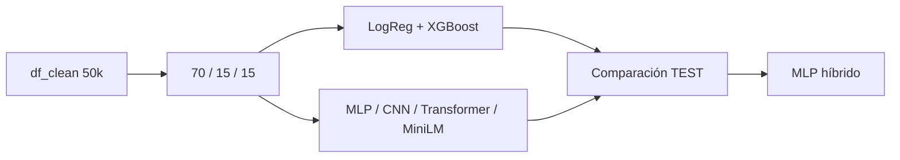

# Fase III — Diseño e implementación experimental

**Módulo 5 · Unidad 4 · Proyecto aplicado**  
**Notebook:** [`M5U4_3_experimental_set_up.ipynb`](M5U4_3_experimental_set_up.ipynb)  
**Autor:** David Martinez

[← Volver al README del proyecto](../README.md)

---

## De qué trata esta fase

Montar el **experimento completo**: reproducir `df_clean`, partir datos, entrenar baselines y modelos profundos, ablacionar, comparar en TEST y decidir el modelo de continuidad con criterio **SOC** (no solo el leaderboard de AUC).



---

## Estructura del notebook

| Sección | Contenido |
|---------|-----------|
| 1. Partición | Pipeline condensado del EDA + split estratificado |
| 2. Diseño | Problema binario, justificación de baselines y arquitecturas |
| 3.1–3.2 | Matrices de features + LogReg L2 + XGBoost |
| 3.3 | MLP híbrido multi-rama (modelo principal) |
| 3.4 | CNN 1D URL, Transformer ligero, MiniLM preentrenado |
| 3.5 | 4 ablaciones sobre el MLP |
| 3.6 | Tabla consolidada de 6 modelos |
| 3.7 | Errores por `threat_label` |
| 3.8 | Benchmark anti-leakage, OOD, stress, curva SOC |
| 3.9–3.11 | Estabilidad (5 semillas), SHAP/Lift, calibración y umbrales |

---

## Definición del problema

| Aspecto | Valor |
|---------|-------|
| Tarea | Clasificación binaria supervisada |
| Target | `is_anomaly ∈ {0,1}` |
| Prevalencia | ≈ **7.99 %** |
| Pérdida | `binary_crossentropy` + `class_weight` |
| Métrica primaria | **PR-AUC** |
| Split | 35 000 / 7 500 / 7 500 (train/val/test), `seed=42` |
| Anti-leakage | `has_query_string` **fuera** del fit |

Inputs heterogéneos → arquitectura híbrida: ~20 numéricas + categóricas OHE + TF-IDF 512 + W2V 48.

---

## Qué se logró

### Modelos entrenados

1. **LogReg L2** (baseline lineal, interpretable).  
2. **XGBoost / GBM** (baseline no lineal tabular).  
3. **MLP híbrido multi-rama** (~92k parámetros; early stopping sobre `val_pr_auc`).  
4. **CNN 1D** sobre tokens de URL + rama tabular.  
5. **Transformer** ligero sobre URL.  
6. **MiniLM** preentrenado (referencia de transferencia).

### Resultado de esta corrida

En TEST, baselines y DL ligeros alcanzan **PR-AUC = 1.000** y **F1 = 1.000** (matriz de confusión perfecta a umbral 0.5).  
**Recall@5 % ≈ 0.62** y **Precision@5 % = 1.0**: el top 5 % de scores captura ~62 % de las anomalías sin FP en ese cupo.

Interpretación correcta:

- El feature engineering + la naturaleza sintética del corpus crean un **techo de separabilidad**.
- La comparación deja de ser “quién detecta mejor” y pasa a **criterio operativo SOC**.

### Ablaciones

A0–A4 reportan Δ PR-AUC = 0 respecto al MLP completo: hay **redundancia** suficiente para sostener el techo. Eso **no** prueba que los bloques sean inútiles en general; prueba saturación en esta muestra. Mantener `has_query_string` fuera sigue siendo la decisión correcta por riesgo de leakage.

### Decisión de continuidad

Orden SOC de desempate (referencia del notebook):

`MLP_híbrido` → `LogReg_L2` → `XGBoost` → `Conv1D_URL` → `Transformer_URL` → `MiniLM`

**Modelo elegido para seguimiento:** MLP híbrido (auditabilidad multimodal + costo de entrenamiento bajo — ~13 s/semilla — frente a transformers).

### Operación SOC (curva de capacidad)

| Capacidad de triage | Efecto observado |
|---------------------|------------------|
| **5 %** | Precision 100 %, Recall ≈ 62–63 %, FPR 0 % — **mejor equilibrio práctico** |
| ≥ 10 % | Cobertura total posible, pero cae precisión y sube carga analítica |

Estabilidad a 5 semillas: PR-AUC / F1 / ROC-AUC = **1.000 ± 0.000** en este corpus.

---

## Qué se aprendió

1. Un split estratificado + test bloqueado es el mínimo para comparar familias con honestidad.
2. Cuando todos saturan, el entregable valioso es la **decisión** (leak-safe, costo, umbral, OOD), no el decimal extra de AUC.
3. Ablaciones con Δ = 0 siguen siendo ciencia: documentan techo y redundancia.
4. `Recall@k` alinea el modelo con la capacidad real del SOC.
5. MiniLM/transformers no son automáticamente mejores si el problema ya es linealmente separable en features artesanales.
6. Calibración y barrido de umbral importan cuando los scores están polarizados en 0/1.

---

## Archivos en esta carpeta

| Archivo | Rol |
|---------|-----|
| `M5U4_3_experimental_set_up.ipynb` | Notebook de la entrega |

---

## Cómo ejecutar

```bash
pip install pandas numpy scikit-learn xgboost tensorflow gensim matplotlib seaborn
# Variable opcional: M5U4_MAX_ROWS=50000
jupyter notebook M5U4_3_experimental_set_up.ipynb
```

El notebook regenera `df_clean` de forma autosuficiente (Drive/Kaggle).

---

## Criterio de cierre

- Partición correcta y reproducible.
- Modelos justificados e implementados.
- Comparación en datos no vistos + lectura operativa (no solo tablas en 1.0).

Siguiente: [Fase IV — Tuning y validación](../Entrega%20proyecto%20fase%20IV/README.md).
