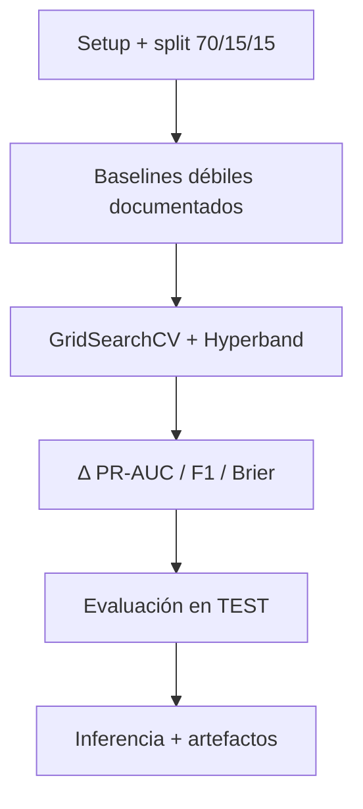

# Fase IV — Entrenamiento, hiperparámetros y validación

**Módulo 5 · Unidad 5 · Proyecto aplicado**  
**Notebook:** [`M5U5 4_modeling.ipynb`](M5U5%204_modeling.ipynb)  
**Autor:** David Martinez

[← Volver al README del proyecto](../README.md)

---

## De qué trata esta fase

Demostrar que el **entrenamiento es adecuado**, que la **selección de hiperparámetros mejora** el desempeño y que los modelos se **comparan** de forma limpia sobre TEST nunca visto.

El notebook es **autónomo**: replica el pipeline de la Fase 3 (carga, features, split, preprocesamiento) y añade tuning explícito.



---

## Mapa rúbrica → sección

| Criterio | Dónde está |
|----------|------------|
| Entrenamiento adecuado / modelo se ajusta | §1.1 LogReg+XGB, §1.2 MLP + EarlyStopping / ReduceLROnPlateau |
| Hiperparámetros mejoran el desempeño | §1.1 GridSearchCV, §1.2 Keras Tuner Hyperband, §1.3 deltas |
| Comparación de modelos | §1.3 (val) y §2.1–2.2 (test) |
| Evaluación en no vistos | §2 TEST + errores por `threat_label` + 10 ejemplos |

---

## Estructura del notebook

| Sección | Contenido |
|---------|-----------|
| 0. Setup | Semillas, Drive/Kaggle, features OWASP+NLP, split, matrices |
| 1.1 | LogReg y XGBoost: débil vs `GridSearchCV` |
| 1.2 | MLP híbrido: débil vs **Hyperband** + re-fit con `class_weight` |
| 1.3 | Tabla 3 familias × 2 estados + Δ métricas |
| 2.1–2.2 | Métricas y curvas en TEST |
| 2.3 | Errores por `threat_label` |
| 2.4 | Aplicación operativa + `artifacts_m5u5/` |
| 3 | Conclusiones mapeadas a la rúbrica |

---

## Diseño del tuning

### Baselines tabulares

- CV estratificado **5-fold** solo sobre **train**.
- `scoring='average_precision'` (proxy de PR-AUC).
- Baseline **débil documentado** (p. ej. LogReg con `C` muy chico y sin `class_weight`; XGB con poca profundidad, `lr` alto y `scale_pos_weight=1`) frente al **tuned**.

### MLP híbrido (modelo profundo principal)

Arquitectura multi-rama (heredada de Fase 3):

```text
num (20)  → BN → Dense → Dropout
cat (OHE) → Dense → Dropout
TF-IDF 512 → Dense → Dropout → Dense
W2V 48 → Dense → Dropout
        → Concat → head → sigmoid
```

Hyperband explora `lr`, `dropout_tfidf`, `dropout_head`, `units_tfidf`, `units_head`, `batch_size`.  
Objetivo del tuner: maximizar `val_pr_auc`.  
Re-fit final con `class_weight ≈ {0:1, 1:11.4}`.

**Anti-leakage:** `has_query_string` sigue fuera (`use_hq=False`).

---

## Qué se logró

### Mejora atribuible al tuning

Cuando PR-AUC ya satura en 1.0 (techo del corpus sintético), el notebook reporta la tríada:

- **Δ PR-AUC**
- **Δ F1**
- **Δ Brier**

Así se ve mejora **probabilística y decisional** aunque el ranking esté en el techo. Los baselines débiles están escritos a propósito para que el Δ no sea ambiguo.

### TEST (holdout estricto)

| Aspecto | Resultado de la corrida documentada |
|---------|-------------------------------------|
| Filas | 7 500 (605 anomalías, 8.07 %) |
| Accuracy / Precision / Recall / F1 | **1.000** (modelos tunados) |
| ROC-AUC / PR-AUC | **1.000** |
| Recall@5 % | **≈ 0.62** |
| Precision@5 % | **1.000** |
| Confusión MLP_tuned | TP=605, TN=6895, FP=0, FN=0 |
| Brier MLP_tuned | ≈ 0 (calibración polarizada 0/1) |

Subclases `malicious` y `suspicious`: recall **1.0** en este TEST.

### Aplicación

- 10 filas de TEST (5 benignas + 5 amenazas) con `prob_anomaly`, decisión y motivo (flag OWASP / TF-IDF).
- Artefactos persistidos para reutilizar inferencia (`model`, `scaler`, `encoder`, `config`).

---

## Qué se aprendió

1. **Tuning no es ornamental:** hay que medirlo contra un default débil *explícito*, no contra un campeón ya saturado sin contraste.
2. Si PR-AUC está en 1.0, **Brier y F1** siguen siendo el lenguaje de mejora.
3. `class_weight` y `scale_pos_weight` no son detalles: sin ellos el modelo “aprende” a ignorar el 8 %.
4. EarlyStopping sobre `val_pr_auc` evita entrenar de más cuando la val ya está plana.
5. Un notebook de Fase 4 debe ser **ejecutable solo**: el evaluador no debería depender de celdas de la Fase 3.
6. Métricas perfectas en un generador sintético se reportan **con esa salvedad**; el valor del entregable es el método (split, leakage, tuning, SOC), no la ilusión de un detector infalible en producción.

---

## Archivos en esta carpeta

| Archivo | Rol |
|---------|-----|
| `M5U5 4_modeling.ipynb` | Notebook de la entrega |

Al ejecutar pueden generarse `artifacts_m5u5/` y caches del tuner en temp.

---

## Cómo ejecutar

```bash
pip install pandas numpy scikit-learn xgboost tensorflow keras-tuner gensim matplotlib seaborn
jupyter notebook "M5U5 4_modeling.ipynb"
```

Detecta automáticamente entorno local (CPU) vs Colab (GPU + `mixed_float16`).

---

## Criterio de cierre (rúbrica)

- Entrenamiento correcto con callbacks y pesos de clase.
- Selección de hiperparámetros con **mejora cuantificada**.
- Comparación multi-familia y evaluación en TEST no visto.

Con esta fase se cierra el hilo del Módulo 5:

| Fase | Entregó |
|------|---------|
| I | Problema SOC + datos a escala |
| II | Features honestas + métricas |
| III | Diseño experimental + MLP híbrido |
| IV | Tuning demostrable + validación |

Volver al [README principal](../README.md).
