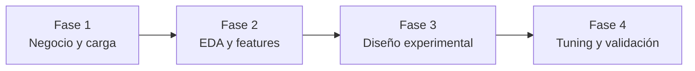

# Detección de anomalías en logs de ciberseguridad

**Diplomado en Machine Learning y Data Science Avanzado · Módulo 5 (Deep Learning)**  
**Universidad Nacional de Colombia**  
**Autor:** David Martinez  
**Profesor:** Fabio Augusto Gonzalez · **Asistente:** Santiago Toledo Cortés

---

## Presentación del portafolio

Este repositorio documenta el **proyecto aplicado del Módulo 5**. El hilo conductor es un sistema de **detección y priorización de amenazas** sobre logs de red y aplicación: cada evento se clasifica como **benigno** o **anómalo**, y el score sirve para que un SOC revise primero lo que más importa.

No es un IDS de firma clásico ni un generador de reglas a mano. Es un pipeline de **Machine Learning + NLP + Deep Learning** sobre un corpus de logs: features estructuradas, señales OWASP sobre `request_path`, TF-IDF / Word2Vec, baselines tabulares y un **MLP híbrido multi-rama**, con selección de hiperparámetros y evaluación sobre holdout.

El trabajo está organizado en **cuatro entregas**. Cada carpeta contiene el notebook de esa fase y un README propio.



| Fase | Carpeta | Notebook | Aporte principal |
|------|---------|----------|------------------|
| I | [`Entrega proyecto fase I`](Entrega%20proyecto%20fase%20I/) | `M5U2_1_business_data_load.ipynb` | Marco SOC + carga Spark (muestra 50k / universo ~6M) |
| II | [`Entrega proyecto fase II`](Entrega%20proyecto%20fase%20II/) | `M5U3_2_exploratory_data_analysis.ipynb` | EDA, NLP de URL, leakage documentado, `df_clean` |
| III | [`Entrega proyecto fase III`](Entrega%20proyecto%20fase%20III/) | `M5U4_3_experimental_set_up.ipynb` | Split, baselines, MLP/CNN/Transformer, ablaciones, decisión SOC |
| IV | [`Entrega proyecto fase IV`](Entrega%20proyecto%20fase%20IV/) | `M5U5 4_modeling.ipynb` | GridSearchCV + Keras Tuner; mejora vs baseline débil; TEST |

---

## De qué trató el proyecto

### Problema de negocio

Los equipos de **SOC / CSIRT** (IT y OT) reciben **millones de logs** (firewall, IDS, aplicación). La revisión manual no escala: hay demasiadas alertas, muchos falsos positivos y riesgo de pasar por alto incidentes reales.

**Objetivo de negocio:** automatizar la detección de eventos inusuales, **reducir falsos positivos**, **priorizar alertas** (qué mirar primero) y acercar un esquema de análisis casi en tiempo real.

### Objetivo técnico

Clasificación **binaria supervisada**:

- Etiqueta: `is_anomaly = 1` si `threat_label != benign`, si no `0`.
- Prevalencia observada en la muestra: **≈ 8 %**.
- Métrica primaria: **PR-AUC** (desbalance + costo FN ≫ FP en operación SOC).
- Métricas secundarias: F1, ROC-AUC, Recall@5 %, Precision@5 %, Brier, matrices de confusión.
- `threat_label` multi-clase se conserva para **auditoría post-mortem**, no como target principal de esta entrega.

### Datos

| Aspecto | Detalle |
|---------|---------|
| Fuente | Kaggle *Cybersecurity Threat Detection Logs* (`aryan208/cybersecurity-threat-detection-logs`), también vía Google Drive |
| Universo | ~**6 000 000** registros |
| Muestra de trabajo | **50 000** filas (pipeline diseñado para escalar) |
| Columnas base | `timestamp`, `source_ip`, `dest_ip`, `protocol`, `action`, `threat_label`, `log_type`, `bytes_transferred`, `user_agent`, `request_path` |
| Naturaleza | Dataset **sintético controlado** (hora truncada, IPs privadas, 0 nulos) — útil para prototipo; las métricas perfectas se interpretan con esa salvedad |

---

## Qué se logró

### Fase 1 — Negocio y carga

- Marco para SOC/CSIRT en IT/OT.
- Carga con **Spark**, esquema explícito, muestra de 50k y Parquet para reutilizar.
- 0 nulos en columnas clave en la muestra; timestamps parseables.

### Fase 2 — Exploración y preparación

- Pipeline reproducible (Drive + fallback Kaggle; Spark con fallback a Pandas).
- Ingeniería sobre `request_path`: entropía, tokens, flags estilo OWASP, scores de riesgo.
- NLP clásico: TF-IDF (norma L2) y Word2Vec; TF-IDF separa clases con fuerza (media L2 ≈ **1.89** benigno vs **6.58** amenaza).
- **Hallazgo crítico:** correlación / asociación `has_query_string` ↔ `is_anomaly` = **1.0** (artefacto del generador). **Decisión:** excluir esa variable del entrenamiento.
- Métricas de diseño fijadas: PR-AUC primaria; no usar accuracy como norte.

### Fase 3 — Diseño experimental

- Split estratificado **70 / 15 / 15** (35k / 7.5k / 7.5k), `seed=42`, test bloqueado.
- Baselines: **LogReg L2**, **XGBoost**.
- DL: **MLP híbrido multi-rama** (numéricas + categóricas + TF-IDF 512 + W2V 48), CNN 1D sobre URL, Transformer ligero, MiniLM preentrenado.
- Ablaciones y benchmark anti-leakage.
- En esta corrida las métricas de ranking/clasificación **saturan en 1.0** en TEST: el criterio de continuidad pasa a ser **SOC** (auditabilidad, costo, mantenimiento). Modelo de continuidad: **MLP híbrido**.
- Curva operativa: con capacidad de triage al **5 %**, Precision **100 %** y Recall ≈ **62–63 %** (punto de equilibrio práctico).

### Fase 4 — Entrenamiento, tuning y validación

- Baselines débiles **documentados** vs tunados (`GridSearchCV`, scoring `average_precision`).
- MLP: baseline débil vs **Keras Tuner Hyperband** + re-fit con `class_weight`.
- Comparación 3 familias × 2 estados con **Δ PR-AUC, Δ F1, Δ Brier**.
- TEST (7 500 filas, 605 anomalías): Accuracy / Precision / Recall / F1 / ROC-AUC / PR-AUC = **1.000** en los modelos tunados de esta corrida; Recall@5 % ≈ **0.62**; Precision@5 % = **1.0**.
- Aplicación sobre 10 filas no vistas + persistencia de artefactos (`artifacts_m5u5/`).
- Conclusión honesta: el techo del generador sintético satura PR-AUC; el valor de la fase está en demostrar que el **tuning aporta** (sobre todo vía F1/Brier cuando PR-AUC ya está en el techo) y que el pipeline es reproducible.

---

## Qué se aprendió

### Sobre el dominio

1. Un SOC no optimiza accuracy: optimiza **priorización bajo capacidad limitada**.
2. `request_path` concentra más señal de intención que `user_agent` en este corpus.
3. Features “obvias” pueden ser **leakage** (`has_query_string`); detectarlas es parte del trabajo científico.
4. Un recall@k al 5 % cuenta más para triage que un F1 en umbral 0.5 cuando los scores están polarizados.

### Sobre ML / Deep Learning

1. Con inputs heterogéneos, un **MLP multi-rama** es una arquitectura natural (tabular + texto vectorizado).
2. Si el dataset es trivialmente separable, baselines y DL **empatan**: hay que desempatar con costo, calibración e interpretabilidad.
3. Las **ablaciones** pueden dar Δ = 0 y aun así informar (redundancia / techo de separabilidad).
4. Reportar un **baseline débil documentado** hace visible el aporte del tuning cuando el techo métrico está saturado.
5. Reproducibilidad: semillas, `TF_DETERMINISTIC_OPS`, split estratificado, test nunca visto en fit/tuning.

### Sobre el stack

- Spark (y Pandas como fallback) para ingesta.
- scikit-learn, XGBoost, TensorFlow/Keras, Keras Tuner.
- gensim Word2Vec (o SVD como sustituto).
- HashingVectorizer + IDF alineado con HashingTF + IDF de MLlib.

---

## Estructura del repositorio

```text
ML Deep Learning/
├── README.md
├── Entrega proyecto fase I/
│   ├── README.md
│   └── M5U2_1_business_data_load.ipynb
├── Entrega proyecto fase II/
│   ├── README.md
│   └── M5U3_2_exploratory_data_analysis.ipynb
├── Entrega proyecto fase III/
│   ├── README.md
│   └── M5U4_3_experimental_set_up.ipynb
└── Entrega proyecto fase IV/
    ├── README.md
    └── M5U5 4_modeling.ipynb
```

> Los CSV/Parquet de 6M o 50k **no** están versionados aquí (peso). Los notebooks descargan desde Drive/Kaggle o asumen el archivo local.

---

## Cómo reproducir (visión general)

```bash
pip install pandas numpy matplotlib seaborn scikit-learn xgboost tensorflow keras-tuner pyspark gensim
# Opcional: kagglehub para la descarga del dataset
```

1. Fase I: carga y muestra 50k (requiere CSV o `kagglehub`).
2. Fase II: EDA y feature engineering (Drive ID o Kaggle).
3. Fase III: setup experimental completo.
4. Fase IV: notebook autónomo (repite el pipeline condensado + tuning).

Cada notebook está pensado para ejecutarse con el working directory = su carpeta (o en Colab con GPU T4).

---

## Lectura sugerida del portafolio

1. Este README (mapa y resultados).
2. [Fase I](Entrega%20proyecto%20fase%20I/README.md) — para quién es el sistema y de dónde salen los datos.
3. [Fase II](Entrega%20proyecto%20fase%20II/README.md) — por qué PR-AUC y por qué se excluye `has_query_string`.
4. [Fase III](Entrega%20proyecto%20fase%20III/README.md) — por qué MLP híbrido y qué significa saturar en 1.0.
5. [Fase IV](Entrega%20proyecto%20fase%20IV/README.md) — cómo el tuning demuestra mejora y cómo se evalúa en TEST.

---

## Créditos académicos

- **Profesor:** [Fabio Augusto Gonzalez](https://dis.unal.edu.co/~fgonza/)
- **Asistente docente:** [Santiago Toledo Cortés](https://sites.google.com/unal.edu.co/santiagotoledo-cortes/)
- **Universidad Nacional de Colombia** — Facultad de Ingeniería

---

*Proyecto aplicado · Módulo 5 · Deep Learning · Diplomado ML & Data Science Avanzado · 2026*
